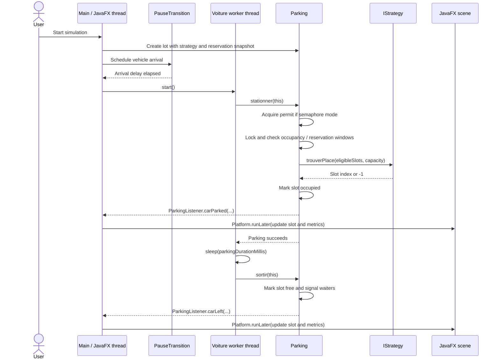

# Technical Report: Smart Parking Prediction & Reservation System

## Introduction and problem statement

In a smart city, drivers benefit from knowing where and when parking capacity may be available. This project demonstrates a small parking facility that coordinates concurrent vehicle arrivals, predicts short-run occupancy from a simulation schedule, estimates typical urban demand from historical city parking records, and lets users reserve numbered spaces. The problem addressed is how to allocate limited spaces safely while giving users both an immediate simulation forecast and a data-based view of demand patterns.

The project combines a local JavaFX simulation with a data-based demand benchmark. It does not connect to live city sensors, maps, payment services, or a live parking database. A bundled historical Birmingham dataset supports a weekday-and-time occupancy predictor; the simulation's short-term forecast separately uses generated arrivals and reservations.

## Objectives and success criteria

1. **Prevent over-allocation:** never assign an occupied space to a second vehicle or exceed configured capacity under concurrent arrivals. Verified by concurrency and lifecycle tests.
2. **Offer two synchronization modes:** support semaphore-based admission and mutex/condition-based waiting in the parking model. Both modes are covered by automated concurrency tests.
3. **Make arrival schedules reproducible:** the same car count, arrival window, and seed produce the same delays. Verified by `ArrivalScheduleTest`.
4. **Enforce reservation rules:** reject bookings that overlap on the same numbered space, run reserved vehicles at the configured offsets, and keep conflicting ordinary stays off those spaces. Covered by reservation manager, forecast, and parking lifecycle tests.
5. **Show two useful occupancy views:** display the schedule-based simulation forecast alongside live occupancy, and estimate typical city demand from historical car-park observations.
6. **Support clean shutdown:** stop pending arrivals, notify/interupt workers, and perform bounded joins away from the UI thread.

## Overview

This project is a JavaFX desktop application that simulates vehicles competing for a fixed number of parking slots. The UI presents the parking lot, occupancy and waiting metrics, a live activity list, and optional charts. A configuration screen lets the user choose the synchronization strategy and simulation size before launch.

## Structure

- `Main.java` builds the JavaFX configuration view and live dashboard, manages arrival timers and worker threads, and implements `ParkingListener` to route callbacks to the JavaFX application thread.
- `Parking.java` owns slot state, wait-time measurements, synchronization, and logging.
- `ParkingListener.java` defines callbacks for parking events without coupling the model to JavaFX.
- `OccupancyForecast.java` estimates occupancy over time from the seeded arrival schedule, configured parking duration, and lot capacity.
- `HistoricalOccupancyPredictor.java` estimates typical city parking demand from historical Birmingham occupancy grouped by car park, weekday, and half-hour.
- `parking-birmingham.csv` contains the attributed UCI historical occupancy dataset used by the city demand predictor.
- `Reservation.java` represents a booking for a numbered space and time interval.
- `ReservationManager.java` assigns spaces to bookings while rejecting overlapping reservations for the same space.
- `Voiture.java` models a vehicle as a worker thread that attempts to park, remains parked for the configured interval, and leaves.
- `DefaultStrategy.java` chooses an available slot.
- `CustomRectangle.java` renders a slot and animates its displayed state.
- `parking.css` defines the application styling.

## Architecture and class diagram

The JavaFX controller (`Main`) coordinates the interface, deterministic arrival schedule, reservation manager, forecast, and parking model. `Parking` owns synchronized occupancy and delegates selection of an eligible slot to `IStrategy`. Each `Voiture` is a worker thread that requests a slot, waits for its parking duration, and releases it. `ParkingListener` carries model events back to the UI without making `Parking` depend on JavaFX.

```mermaid
classDiagram
    class Main {
        +start(Stage)
        -startSimulation()
        -stopSimulation()
        +carParked(...)
        +carLeft(...)
        +parkingMetrics(...)
    }
    class JavaFXApplication {
        <<JavaFX Application>>
    }
    class StackPane {
        <<JavaFX StackPane>>
    }
    class Parking {
        +stationner(Voiture)
        +sortir(Voiture)
        +shutdown()
        -findPlace(Voiture) int
    }
    class Voiture {
        +run()
        -parkingDurationMillis long
        -reservation Reservation
    }
    class IStrategy {
        <<interface>>
        +trouverPlace(List~Boolean~, int) int
    }
    class DefaultStrategy
    class ParkingListener {
        <<interface>>
        +carParked(...)
        +carLeft(...)
        +parkingMetrics(...)
    }
    class ArrivalSchedule {
        +generateDelaysMillis(int, int, long) List~Integer~
    }
    class OccupancyForecast {
        +predict(List~Integer~, int, int, List~Reservation~) List~Point~
    }
    class HistoricalOccupancyPredictor {
        ~carParkIds() List~String~
        ~predict(String, DayOfWeek, LocalTime) Optional~Prediction~
        ~validationMetrics() ValidationMetrics
    }
    class ReservationManager {
        +reserve(String, int, int) Optional~Reservation~
        +all() List~Reservation~
        +cancel(String) boolean
    }
    class Reservation {
        +id String
        +vehicleId String
        +slotNumber int
        +startOffsetSeconds int
        +durationSeconds int
        +endOffsetSeconds() int
    }
    class CustomRectangle
    class BirminghamData {
        <<public CSV dataset>>
        +SystemCodeNumber
        +Capacity
        +Occupancy
        +LastUpdated
    }

    Main ..|> ParkingListener
    Main --|> JavaFXApplication
    CustomRectangle --|> StackPane
    Main --> Parking : creates and coordinates
    Main --> ArrivalSchedule : generates arrivals
    Main --> OccupancyForecast : builds forecast
    Main --> HistoricalOccupancyPredictor : shows city demand estimate
    Main --> ReservationManager : manages bookings
    Main --> CustomRectangle : renders slots
    Parking --> IStrategy : selects slot
    DefaultStrategy ..|> IStrategy
    Parking --> ParkingListener : publishes events
    Parking --> Reservation : checks booked intervals
    Voiture --> Parking : park and leave calls
    Voiture --> Reservation : optional booking
    ReservationManager --> Reservation : creates and stores
    OccupancyForecast --> Reservation : models booked intervals
    HistoricalOccupancyPredictor --> BirminghamData : trains and validates from
```

`BirminghamData` in the diagram is the bundled `parking-birmingham.csv` public dataset, not a Java class.

## Vehicle parking sequence

The arrival timer runs on the JavaFX application thread. When it expires, `Main` starts a `Voiture` worker. `Parking` allocates a slot under synchronization, then publishes updates through `ParkingListener`; `Main` sends visual changes to the JavaFX thread. The worker sleeps for the configured stay and then releases its slot.

## Thread methods used

- `Thread.start()` is called for each scheduled or manually spawned `Voiture`. It asks the JVM to run that object's `run()` method on a separate worker thread; calling `run()` directly would not create a new thread.
- `Thread.sleep(parkingDurationMillis)` in `Voiture.run()` simulates the time a vehicle remains parked. It releases CPU time while the car stays represented as occupying its slot, and responds to interruption by throwing `InterruptedException`.
- `Thread.interrupt()` is called during shutdown to request that workers stop. A sleeping or waiting worker receives an interruption; the `Voiture` worker restores its interrupt flag and leaves through its `finally` cleanup if it had parked.
- `Thread.join(timeout)` is used by the cleanup thread to wait for workers to finish, with a bounded overall shutdown wait. The cleanup runs off the JavaFX thread so the interface remains responsive.

The application does not use deprecated `Thread.stop()`: shutdown is cooperative through the `active` flag, condition signaling, and interruption.

## Threading and synchronization

The JavaFX application thread creates and updates scene graph nodes. `Parking` reports state changes through the optional `ParkingListener`; the UI implementation routes callbacks through `runOnFxThread` and `Platform.runLater`. The parking model can be used without a listener, including in unit tests.

`Parking` protects its occupied-slot list, waiting count, and wait-time map with a fair `ReentrantLock`. Semaphore mode uses a fair semaphore with one permit per slot. Mutex mode waits on a `Condition` while all slots are occupied and signals waiters when a vehicle leaves. `active` is volatile so workers can observe shutdown state. The worker list and arrival transitions are managed by the JavaFX application thread.

Application logs are written to `~/.parkflow/parking.log` by default, with rotation at 1 MB across three files. The `parkflow.log` system property can override the destination.

## Historical demand prediction

The analytics panel lets the user select one Birmingham car park, a weekday, and a half-hour between 08:00 and 16:30. The predictor converts each historical observation to an occupancy ratio (`occupancy / capacity`), groups valid observations by car park, weekday, and nearest half-hour, and averages each group. It scales the predicted ratio by that car park's most common capacity to show estimated occupied and available spaces. If an exact group has no observations, it falls back to the same car park's weekday profile and then its overall average.

The bundled UCI file has 35,717 source rows for 30 car parks. The parser retains 35,332 valid observations and skips malformed or out-of-range rows. Validation is chronological: data before 5 December 2016 forms the profile; data from 5 December through 19 December is held out. On 6,958 held-out observations, the weekday/time profile has **6.77% MAE**, compared with **17.45% MAE** for a baseline that always predicts the training average for that car park. This result supports the use of time and weekday patterns on this dataset; it does not imply the same error on current data or another city.

## Lifecycle

Launching the dashboard initializes a new `Parking` instance and schedules each configured vehicle with a `PauseTransition` over the configured arrival window. A user-selected seed reproduces the list of arrival delays, though thread scheduling can still change parking order. `OccupancyForecast` predicts scheduled and reserved parking intervals, then builds an occupancy timeline for comparison with actual occupancy. Manual spawns are excluded from the forecast, and thread timing can still make actual behavior differ. The manual spawn action starts an additional vehicle immediately. Each car remains parked for the configured duration. Restart and settings actions stop pending arrival transitions, shut down the current parking instance, interrupt workers, and clear the tracking lists without blocking the JavaFX thread. A daemon cleanup thread joins the interrupted workers with a two-second overall limit. UI callbacks compare their source `Parking` instance with the current instance to ignore stale updates.

Reservations use offsets in seconds from the next simulation start. `ReservationManager` assigns the lowest available numbered space and prevents two bookings from overlapping on that space. Reserved vehicles join the live simulation at their booked offsets and use the assigned space. Random and manually spawned cars cannot select a space if their configured parking duration would overlap a booking; waiters recheck eligibility when a reservation window ends. Users manage bookings before launch; changes apply to the next run. Bookings remain in memory while the application is open.

## Limitations and verification

The implementation creates one Java thread per vehicle, so very large vehicle counts can consume substantial resources. The Birmingham dataset is historical (October–December 2016) and represents car parks in Birmingham, UK; it is a benchmark, not current local occupancy for the user's city. The weekday/time profile cannot capture events, weather, closures, or recent policy changes. The short-run simulation forecast models scheduled arrivals and reservations; manual spawns are not included. Operating-system scheduling can delay a reserved vehicle slightly past its planned arrival. Reservations and settings are kept in memory and reset when the application closes.

The earlier application suite contains 18 tests across schedule generation, slot strategy, parking concurrency and lifecycle, forecast allocation, and reservation management. The current predictor was compiled and the JavaFX runtime image rebuilt with tests skipped; the app launched and loaded the bundled dataset. Its in-app holdout result is 6.77% MAE versus 17.45% for the per-car-park average baseline across 6,958 observations. Run the full test suite after this update and manually exercise the city prediction controls, reservation creation/cancellation, both synchronization modes, input validation, and shutdown during active traffic on the presentation machine.

## Results and discussion

The tested model maintains the configured capacity while multiple vehicle workers compete for spaces. Seeded arrivals make the planned input schedule repeatable, while thread execution order can still vary. Reservation checks reject overlapping bookings on one space; reserved vehicles use their assigned spaces, and other vehicles avoid a space when their expected stay intersects a booking. The forecast represents these planned intervals and can be compared with live occupancy in the dashboard.

The predictor is an interpretable historical pattern baseline rather than a complex machine-learning model. A chronological holdout avoids evaluating the weekday/time estimate on the same dates used to build its profile. It demonstrates data-driven prediction against a simple baseline, but it does not establish accuracy for another city or for current Birmingham operations. A deployment would need recent local occupancy data and monitoring for model drift. Operational deployment would also need persistent reservations, identity and authorization, network services, and recovery from machine failure.

## Conclusion

The project demonstrates a Java-based smart parking system that combines a JavaFX interface, multithreaded vehicle arrivals, two synchronization strategies, a reproducible simulation schedule, reservations, and a historical-data occupancy prediction benchmark. Its real-world data source and held-out error comparison give the Smart City theme a concrete urban-intelligence component. The result remains a prototype: its historical Birmingham model is not live and should not be presented as a current production prediction service.

## References

1. Oracle. *Thread (Java SE 21 & JDK 21).* [Java Platform API](https://docs.oracle.com/en/java/javase/21/docs/api/java.base/java/lang/Thread.html).
2. Oracle. *Semaphore (Java SE 21 & JDK 21).* [Java Platform API](https://docs.oracle.com/en/java/javase/21/docs/api/java.base/java/util/concurrent/Semaphore.html).
3. Oracle. *Condition (Java SE 21 & JDK 21).* [Java Platform API](https://docs.oracle.com/en/java/javase/21/docs/api/java.base/java/util/concurrent/locks/Condition.html).
4. OpenJFX. *Platform (JavaFX 21).* [JavaFX API](https://openjfx.io/javadoc/21/javafx.graphics/javafx/application/Platform.html).
5. Stolfi, D. (2017). *Parking Birmingham* [Dataset]. UCI Machine Learning Repository. [https://doi.org/10.24432/C51K5Z](https://doi.org/10.24432/C51K5Z). CC BY 4.0. The bundled CSV is attributed to the UCI dataset; malformed and out-of-range occupancy rows are excluded from the predictor.

These references document the Java and JavaFX APIs used by the implementation. The application code and its behavior are described from the project source and test suite.

## AI assistance and academic integrity declaration

OpenAI Codex was used as a coding and writing assistant during project development. Assistance included reviewing the existing application, proposing and implementing code changes, writing and updating tests and documentation, integrating reservations with the live simulation and forecast, renaming project display/build names, and drafting the diagrams and explanations in this report. The team remains responsible for understanding, reviewing, and presenting the final work, and should edit this disclosure if any of these details are inaccurate for the group.

**Group declaration (complete and sign before submission):** We have reviewed the submitted source and report, understand the work we are presenting, and have disclosed AI assistance and other external contributions truthfully. We have checked all references and verified the claims we make. Group members: `[add names and student IDs]`. Date: `[add date]`.

**Evidence to attach:** this document summarizes AI-assisted work; it is not a raw prompt transcript. Add the required prompt logs and screenshots from the team's actual AI sessions, identify the tools and versions used, and list any third-party code, assets, or sources not already cited above. Do not claim evidence that was not collected.
